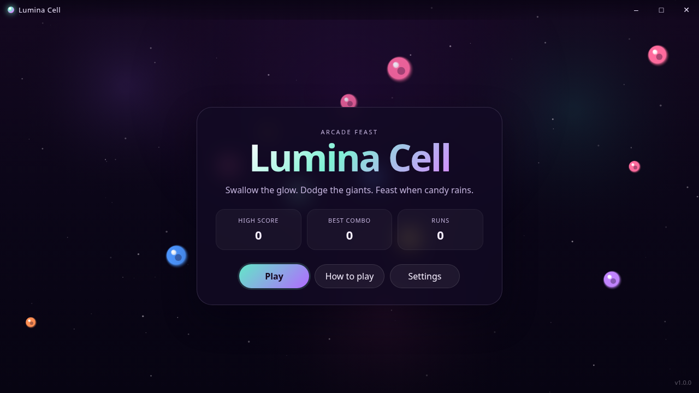
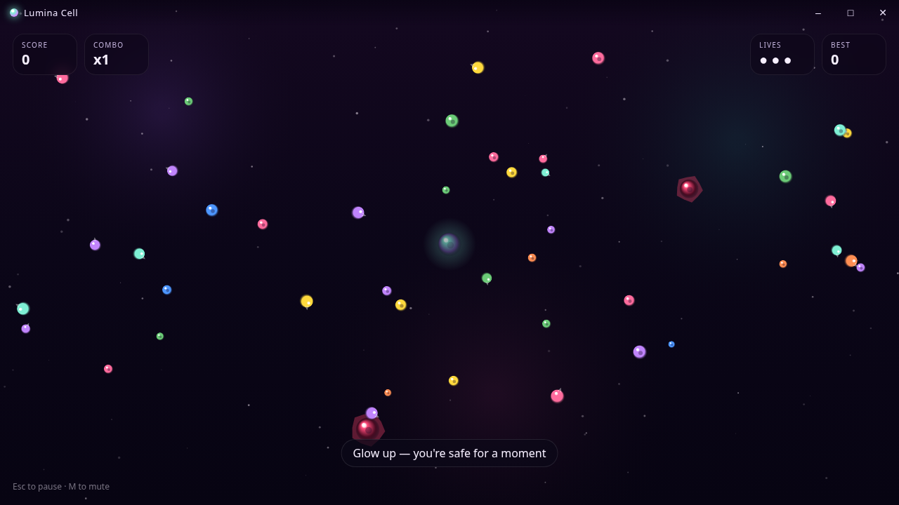
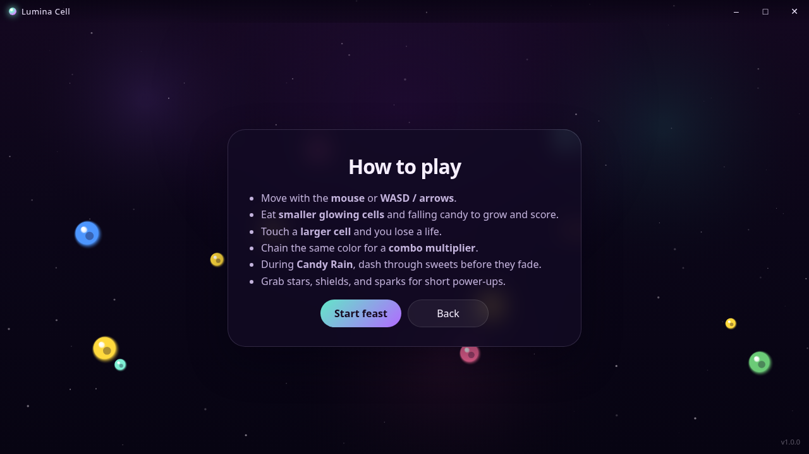

# Lumina Cell One

A free, offline arcade survival game from **BLUE BAY SOFTWARE DEVELOPERS LLC**.

**[Download for Windows (64-bit)](https://github.com/dillionharper635/lumina-cell-one/releases/latest/download/LuminaCell.exe)** · [All releases](https://github.com/dillionharper635/lumina-cell-one/releases)



Guide a glowing cell through a colorful arena. Eat smaller cells and falling candy to grow, dodge larger predators, and chain matching colors for combo multipliers.

- Offline single-player arcade survival
- Mouse, WASD, and arrow-key controls
- Timed Candy Rain events and temporary power-ups
- Easy, Normal, and Rush difficulty
- Local high scores and combo records
- Mute and reduced-motion options



## Install and play

1. Download `LuminaCell.exe` from the release above.
2. Open the installer and follow its prompts.
3. Launch **Lumina Cell**. The installer and in-game interface retain that title.

Move with your mouse, WASD, or the arrow keys. Press Esc to pause and M to toggle sound. Scores and settings are saved on your computer.



## Release verification

Version **1.0.0**. The installer is digitally signed by **BLUE BAY SOFTWARE DEVELOPERS LLC**. Its signature was verified on Windows before publication.

SHA-256 of `LuminaCell.exe`:

```text
84f2b507a70077daf2149f8a4ae37f8636469a1eaeaa675658d7e2237751c58d
```

The release includes `SHA256SUMS.txt` and installation instructions. This repository distributes the Windows installer and release documentation.

## Support

[info@bluebaysoftware.dev](mailto:info@bluebaysoftware.dev)
